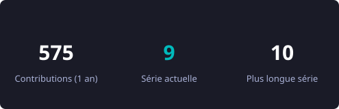
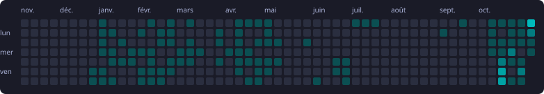

 

## 🛠️ Projets

<!-- PROJETS:DEBUT -->
| Projet | Ce que ça fait | Langage | ⭐ | Dernière maj |
|---|---|:-:|:-:|:-:|
| [**tester-Libft**](https://github.com/enadeaud/tester-Libft) | Testeur « sardine » : comparaison avec la libc, Valgrind, malloc mis en échec, fuzzing, norme | C | 13 | 2026-11-10 |
| [**betise-piscine**](https://github.com/enadeaud/betise-piscine) | De petits malus, beaucoup d’absurdité, et parfois Shrek. | Python | 5 | 2026-11-06 |
| [**Testeur-Printf**](https://github.com/enadeaud/Testeur-Printf) | Testeur « rubben » pour ft_printf : comparaison avec printf, bonus (flags, largeur), Valgrind, norme | C | 4 | 2026-11-06 |
| [**Testeur-Codexion**](https://github.com/enadeaud/Testeur-Codexion) | Testeur-Codexion : Stress-test de Codexion : simulations fifo / edf, précision du burnout, helgrind & drd | Shell | 4 | 2026-10-20 |
<!-- PROJETS:FIN -->

📱 **NetPractice Trainer** *(en cours)* : appli Android pour s'entraîner à NetPractice (cours, quiz, exercices générés, mode défense).

## 💻 Stack

## 📊 Activité

  

